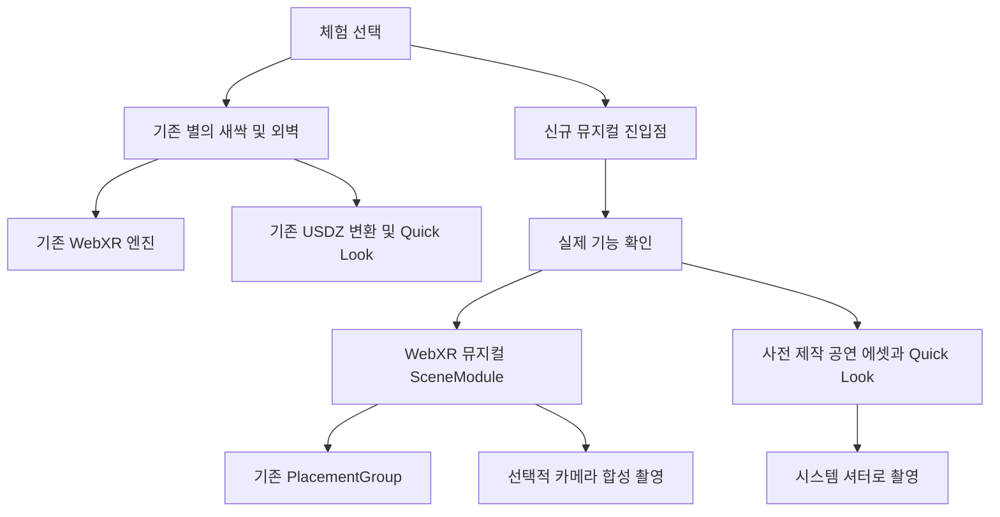

# iPhone 공간 추적 분석과 2인 뮤지컬 및 사진 촬영 확장 설계

작성일: 2026-10-29. 대상: 현재 작업 트리의 `ar-engine` 및 실제 스테이징된 모델. 상태: 코드 분석·로컬 호환성 검사 완료, 신규 기능은 설계 단계.

현재 iPhone은 **AR Quick Look에 USDZ를 전달하고, 네이티브 뷰어가 ARKit 기반 공간 추적과 배치를 수행**한다. Android는 **Three.js와 WebXR의 hit-test 결과로 월드 좌표에 모델을 배치**한다. 두 경로를 유지하면서 뮤지컬을 추가할 수 있다. 다만 현재 GLB→USDZ 변환에는 애니메이션·음성 내보내기가 없으므로, iPhone 공연은 사전 제작한 별도 네이티브 에셋이 필요하다. 사진은 iPhone의 시스템 촬영과 Android의 조건부 합성 촬영을 구분한다.

사용자가 iPhone·Android에서 확인한 공간 고정 표시를 기존 동작의 기준선으로 삼았다. 이번 검증은 로컬 코드·에셋·빌드에 대한 검사이며, 휴대폰에서 공연이나 사진 기능을 실행한 결과를 의미하지 않는다. 원래 수정 중이던 소스 5개와 기존 모델·설정·문서는 변경하지 않았다. 검사 결과 수치는 [호환성 검증 기록](./iphone-tracking-compatibility.json)에 보관한다.

## 1. 분석 기준과 코드 위치

기준 Git HEAD는 `82bfc3ed2e5f111098418d7e2e0cb7eda135fea9`이다. 분석 시작부터 `index.html`, `src/engine.ts`, `src/main.ts`, `src/types.ts`, `vite.config.ts`에 미커밋 변경이 있었으며 **그 변경을 포함한 현재 코드**를 분석했다. 실제 휴대폰의 배포본과 동일한지는 화면의 `build` 값으로 대조해야 한다. `README.md`·`DEVICE-TEST.md`의 Android 전용 설명보다 현재 실행 코드를 우선했다.

| 근거 | 확인 내용 |
| --- | --- |
| [`src/main.ts:317`](../src/main.ts#L317) | iOS 및 `relList.supports("ar")` 감지, USDZ 준비, Blob URL 연결 |
| [`index.html:100`](../index.html#L100) | `rel="ar"` 링크와 단일 `img` 자식, iPhone 전용 진입 버튼 |
| [`src/engine.ts:107`](../src/engine.ts#L107) | `exportExperienceUSDZ()`의 GLB→USDZ 변환 |
| [`src/engine.ts:154`](../src/engine.ts#L154) | Android `immersive-ar` 요청과 선택 기능 |
| [`src/engine.ts:327`](../src/engine.ts#L327) | `local-floor` 우선, 실패 시 `local` 참조 공간 |
| [`src/core/placement.ts:18`](../src/core/placement.ts#L18) | 외곽 Group에 배치 변환, 내부 모델 애니메이션 분리 |
| [`src/engine.ts:667`](../src/engine.ts#L667), [`718`](../src/engine.ts#L718) | 탭 배치, hit-test, 프레임 갱신 |
| [`src/scenes/emergingArtwork.ts`](../src/scenes/emergingArtwork.ts) | `Emerge`·`Idle`·`Disappear` 재생과 초기 숨김 |
| [`src/scenes/alignmentScene.ts`](../src/scenes/alignmentScene.ts) | 외벽 레이어 표시·숨김 |
| [`scripts/stage-assets.mjs`](../scripts/stage-assets.mjs), [`vite.config.ts`](../vite.config.ts) | 5개 파일 스테이징, `.assets`에서 개발·배포 에셋 공급 |

설치된 버전은 Three.js **0.169.0**, Vite **5.4.21**, TypeScript **5.9.3**이다. 설계는 현재 버전을 기준으로 하며 라이브러리 업그레이드를 전제로 하지 않는다.

## 2. iPhone에서 공간 고정이 이루어지는 과정

### 2.1 웹페이지와 네이티브 뷰어의 역할

현재 실행 흐름은 다음과 같다.

```text
iPhone/iPad 판별 또는 rel="ar" 지원 감지
  → buildStartRequest(experienceId)
  → engine.exportExperienceUSDZ(request)
  → 매니페스트 해석 → GLTFLoader로 GLB 로드
  → root.updateWorldMatrix(true, true)
  → Three.js USDZExporter.parseAsync(root)
  → Blob(model/vnd.usdz+zip) → URL.createObjectURL()
  → <a rel="ar" href="blob:..."></a> 탭
  → Apple AR Quick Look에서 실제 공간에 배치·추적·렌더링
```

별의 새싹은 카탈로그 매니페스트의 `starseed_sculpture`를, 외벽은 `overrides.manifestUrl`의 `alignment_test_facade.manifest.json`을 사용한다. `main.ts`는 두 모델을 순서대로 미리 변환하고 준비된 링크만 활성화한다. iPhone 경로는 `engine.start()`나 WebXR 세션을 시작하지 않는다.

Quick Look은 ARKit이 찾은 실제 표면에 콘텐츠를 놓고 사용자가 이동·크기를 조절할 수 있는 시스템 뷰어다. 따라서 웹 코드의 직접 역할은 **에셋 준비와 뷰어 실행**이다. 공간 추적은 네이티브에 위임된다. [Apple Quick Look 문서](https://developer.apple.com/documentation/arkit/previewing-a-model-with-ar-quick-look)

### 2.2 추적 기술의 의미

Apple이 설명하는 ARKit 월드 추적은 카메라 영상의 특징점 변화와 기기의 관성 센서 정보를 결합하는 **시각 관성 오도메트리(VIO)**다. 기기의 위치와 방향을 추정하고 가상 공간과 실제 공간의 대응을 유지한다. 카메라를 이동해도 물체가 같은 장소에 보이는 것은 이 월드 추적 동작과 일치한다. 조도·표면 특징·급격한 움직임은 추적 품질에 영향을 준다. [Apple 월드 추적 설명](https://developer.apple.com/documentation/arkit/understanding-world-tracking)

**코드로 직접 확인한 사실은 Quick Look 위임까지**다. 위 VIO 설명은 Apple 공개 구조에 따른 해석이며, 이 저장소에서 ARKit 설정이나 내부 알고리즘을 구현한 것은 아니다. LiDAR 사용, GPS 고정, 이미지 마커 추적, VPS 사용은 현재 코드에서 확인되지 않는다. 특정 iPhone의 LiDAR 탑재를 동작 조건으로 가정하지 않는다.

### 2.3 모델 배치 규칙

현재 설치된 `node_modules/three/examples/jsm/exporters/USDZExporter.js`의 기본값은 다음과 같다.

```ts
ar: {
  anchoring: { type: "plane" },
  planeAnchoring: { alignment: "horizontal" }
}
// 생성 USD: metersPerUnit = 1, upAxis = "Y"
```

`exportExperienceUSDZ()`가 이 기본값을 변경하지 않으므로 **별의 새싹과 외벽 모두 수평면 배치용 에셋**으로 전달된다. 외벽은 수직으로 서 있는 모델을 바닥에 놓는 방식이다. 실제 건물의 외벽을 자동 인식하여 등록하는 구현과 구분해야 한다.

GLB 규약은 1 unit = 1 m, Y-up, 정면 -Z이며, `ANCHOR_Ground` 또는 `ANCHOR_Facade`가 모델의 로컬 기준점이다. 현재 익스포터는 메시별 `matrixWorld`를 USD 변환에 기록한다. GLB의 `ANCHOR_*` 이름이 브라우저가 제어할 수 있는 ARKit 앵커로 승격되는 것은 아니다.

iPhone 변환에서는 `PlacementGroup`, `AlignmentScene`, `EmergingArtworkScene`을 만들지 않는다. 따라서 Android의 수동 보정·레이어 토글·애니메이션 상태 머신이 전달되지 않는다. `overrides.scale` 및 매니페스트의 `recommended_scale`도 이 내보내기 함수에서는 적용하지 않는다. 현재 두 모델의 권장 배율은 1이므로 현재 사례의 배율에는 문제가 없지만, 신규 에셋은 제작 시 미터 단위를 맞춰야 한다.

### 2.4 현재 USDZ의 애니메이션 호환 한계

현재 함수는 `loadGLB()` 결과 중 `root`만 익스포터에 전달하며 `animations`를 넘기지 않는다. 설치된 r169 익스포터도 애니메이션 타임 샘플, 스켈레톤 애니메이션, 음성 트랙을 작성하지 않는다. 재질은 `MeshStandardMaterial` 계열을 처리하고, 메시별 정적 기하와 변환을 기록한다.

실제 스테이징 GLB를 변환·압축 해제하여 다음을 확인했다.

| 에셋 | 입력 GLB | 입력 클립 | 출력 USDZ | 메시 수 | USD 시간 샘플 |
| --- | ---: | --- | ---: | ---: | --- |
| 별의 새싹 | 174,832 B | Emerge, Idle, Disappear | 501,820 B | 4 → 4 | 없음 |
| 외벽 시험물 | 108,412 B | 없음 | 293,740 B | 11 → 11 | 없음 |

두 변환 모두 경고 없이 완료됐고 미터 단위·Y-up·수평면 앵커 정보를 유지했다. 즉 **현재 iPhone에서 정적 모델이 공간 고정되는 성공과 뮤지컬 재생 가능성은 별도 검증 사항**이다. Quick Look 자체는 애니메이션과 오디오를 지원하므로, 새 공연은 이 기능을 포함하도록 사전 제작한 파일로 공급한다. [Apple Quick Look 갤러리](https://developer.apple.com/quick-look-gallery/)

## 3. Android의 추적과 배치

1. 사용자 클릭에서 `requestSession("immersive-ar")`를 바로 호출한다. 필수 기능은 `hit-test`, 선택 기능은 `dom-overlay`, `light-estimation`, `anchors`, `local-floor`다.
2. 월드 참조 공간을 `local-floor → local` 순서로 결정하고 Three.js에 설정한다. 별도로 `viewer` 공간에서 hit-test 소스를 만든다.
3. 프레임마다 `getHitTestResults()`의 첫 포즈를 **월드 참조 공간 기준**으로 얻어 레티클에 적용한다.
4. 탭하면 레티클 행렬을 `PlacementGroup.placeAt(matrix, true)`에 전달한다. 위치와 yaw만 채택하여 모델을 세운다. 로드 전 탭은 `pendingPlaceMatrix`에 보관한다.
5. 배치 후에는 hit-test 결과로 모델을 계속 이동시키지 않는다. 월드에 놓인 외곽 Group은 유지하고 XR 카메라가 갱신된다. 내부 모델의 로컬 애니메이션만 별도로 재생한다.

```text
Three.Scene
└─ PlacementGroup           ← 실제 공간의 위치·yaw·배율
   └─ GLB root
      └─ ANCHOR_* / meshes  ← 모델 로컬 TRS와 애니메이션
```

`anchors`를 선택 기능으로 요청하지만 `XRAnchor` 생성·갱신 코드는 없다. 현재 공간 고정은 참조 공간의 월드 좌표 유지 방식이며, `ANCHOR_*` 노드는 glTF 노드다. `light-estimation`도 요청만 하고 렌더링에는 고정 HemisphereLight·DirectionalLight를 사용한다.

외벽 보정값은 `ar-calib:<buildingId>:<spotId>:<assetId>` 키로 위치·Euler 회전·배율을 localStorage에 저장한다. **새 세션의 원점이 이전 세션과 같다는 보장은 없으므로 이를 영속 공간 앵커로 재사용하면 안 된다.** 신규 공연은 이전 외벽 세션의 좌표를 자동 승계하지 않고, 새로 배치하거나 같은 활성 세션 안에서만 명시적인 로컬 변환을 공유한다.

외벽 매니페스트는 `synthetic_alignment_fixture`, `surveyed_real_building: false`다. 6 × 3.6 m 기준선은 합성 시험물의 규격이며 실제 관사 16호의 측량·자동 정합을 의미하지 않는다.

## 4. 호환성 검증 결과

| 검사 | 결과 | 검증 범위 |
| --- | --- | --- |
| `npm run typecheck` | 통과 | 현재 작업 트리의 엄격 TypeScript 검사 |
| `npm run verify:asset` | 통과 | 실제 GLB의 등장·대기·퇴장, Idle 최대 yaw 2° |
| `npm run verify:alignment` | 통과 | 외벽의 레이어 5종·기준점 11개·기준선 6 m/3.6 m |
| 현재 `.assets` GLB 대조 | 통과 | 별의 새싹 원본 및 외벽 worktree 원본과 SHA-256 일치 |
| 현재 USDZExporter 실제 실행 | 통과 | 두 모델 정적 변환·전체 메시 출력·단위·수평면 정보 |
| 실제 PlacementGroup 코드 실행 | 통과 | 위치 보존, pitch/roll 제거, yaw 유지, 배율 1, 자식 애니메이션이 외곽 배치를 변경하지 않음 |
| 루트 경로 Vite 빌드 | 통과 | 기존 `.assets`를 사용한 프로덕션 번들 생성 |
| `/Counting-the-Stars-at-Night/` base 빌드 | 통과 | 서브경로 번들 생성 및 HTML 모듈 경로 확인 |
| 임시 빌드의 두 GLB 대조 | 통과 | 스테이징 모델과 SHA-256 일치 |

빌드는 기존 `dist`를 덮어쓰지 않고 임시 디렉터리에서 실행했다. `npm run build`의 `prebuild`가 기존 `.assets`를 다시 쓰므로, 이번에는 `node node_modules/vite/bin/vite.js build --outDir <임시경로>`로 Vite를 직접 실행했다. 따라서 **에셋 스테이징 재실행은 이번 검사에 포함되지 않는다.** 빌드에서 기존 약 623 kB 메인 청크의 크기 경고가 있었으나 오류는 없었다. 기존 소스·설정·문서·스테이징 및 원본 모델 38개 파일의 검사 전후 SHA-256은 모두 일치했다.

새 공연·카메라 합성·Quick Look 촬영은 아직 구현하지 않았다. 실제 기기의 재배치 안정성, 오디오 동기, 촬영 결과는 아래 실기기 관문을 통과해야 한다.

## 5. 확장 구조

### 5.1 기존 경로 보존과 신규 경로 분리

기존 두 버튼·요청 형식·이벤트·GLB·USDZ 변환 함수·보정 저장 키를 유지한다. 새 `historical-musical-duet` 체험에만 별도 진입점을 추가하고 기본 비활성 플래그로 보호한다. 신규 실패가 별의 새싹이나 외벽 초기화를 막지 않도록 코드와 에셋을 지연 로드한다.



현재 `category` 타입이 확장 가능해도 실제 로더는 카테고리별 장면 라우터가 아니다. 카탈로그 경로는 항상 `EmergingArtworkScene`, `overrides.manifestUrl` 경로는 항상 `AlignmentScene`을 만든다. `advanceScene()`도 경고만 출력한다. **매니페스트에 `roleplay_scene`을 추가하는 것만으로 공연이 실행되지 않는다.**

향후 구현에서는 다음 파일을 추가한다. 아래 파일은 이번 작업에서 생성하지 않는다.

| 예정 파일 | 책임 |
| --- | --- |
| `src/musical/createMusicalExperience.ts` | 신규 체험의 플랫폼 선택·기능 보고·기존 API와 독립된 제어 |
| `src/musical/manifest.ts` | 공연 매니페스트 검증·base URL 해석 |
| `src/scenes/musicalScene.ts` | 두 인물·애니메이션·공연 상태·공통 무대 루트 |
| `src/musical/timeline.ts` | 음원 기준 시간, 장면·자막·립싱크 |
| `src/musical/quickLook.ts` | 사전 제작 USDZ/Reality 링크와 사용자 안내 |
| `src/capture/webxrPhotoCapture.ts` | 허용된 XR 카메라 프레임과 가상 장면의 정지 사진 합성 |
| `src/capture/types.ts` | 촬영 가능·시스템 위임·불가 결과 구분 |
| `scripts/stage-musical-assets.mjs` | 신규 공연 파일만 추가 스테이징 |

Android 연결에는 엔진 내부에 **선택적 장면 확장 연결부**가 필요하다. 렌더러·장면·카메라·배치가 private이므로 외부에서 현재 공개 API만 호출해 새 모델을 삽입할 수는 없다. 향후 변경 지점은 다음으로 제한한다.

- 새 진입점만 제공하는 장면 팩토리가 해당 체험 ID를 처리한다. 기존 호출에는 확장이 없어서 원래 로딩 분기로 들어간다.
- 장면 모듈에 `object`, `onPlaced`, `update`, `onSelect`, `dispose`를 제공한다. 기존 렌더 루프와 `PlacementGroup`에 연결하되 별도 RAF나 두 번째 XR 세션을 만들지 않는다.
- 새 공연의 세션 요청에만 선택적 `camera-access`를 넣는다. 기존 두 체험의 세션 옵션은 유지한다.
- 프레임의 캡처 연결부는 사진 요청이 있을 때만 실행한다. 종료 시 새 모듈의 음원·GPU 자원·리스너·비동기 요청을 정리한다.

현재 엔진의 공개 타입에 새 필수 메서드를 추가하지 않는다. 기존 `animationPhase` 이벤트 열거형을 공연 상태로 바꾸지 않고 새 `musicalStateChanged` 등을 신규 API에 둔다. 원래 `experienceCompleted`의 발생 시점도 유지한다.

### 5.2 기능 보고와 제어 API 초안

기존 `checkSupport()`는 WebXR만 검사하고 `anchors`·`domOverlay` 등을 낙관적으로 표시한다. 신규 계층은 이를 실제 지원 확정값으로 사용하지 않고, 별도의 기능 보고를 제공한다. 새 iPhone 진입은 `relList.supports("ar")` 같은 실제 기능 확인을 우선하며 사용자 에이전트만으로 사용 가능하다고 확정하지 않는다.

```ts
type MusicalCapabilities = {
  backend: "webxr" | "quick-look" | "unavailable";
  playbackControl: "application" | "system" | "none";
  placementTelemetry: boolean;
  photoMode: "webxr-composite" | "native-user" | "os-screenshot" | "none";
  returnsPhotoBlob: boolean;
};

type PhotoActionResult =
  | { kind: "captured"; blob: Blob; width: number; height: number }
  | { kind: "delegated"; target: "quick-look-shutter" | "os-screenshot" }
  | { kind: "unavailable"; reason: string };

// 신규 API만 제공: prepare(), startFromUserGesture(), pause(), resume(),
// seek(seconds), requestPhoto(), dispose(), getCapabilities().
// Quick Look의 웹 제어 불가 메서드는 capability에 따라 명시적으로 거부한다.
```

Quick Look 실행 링크 탭을 `placed`·`performanceCompleted`·`photoCaptured`로 보고하지 않는다. 페이지 복귀나 `visibilitychange`도 공연 완료·사진 저장의 증거가 아니다. iPhone은 네이티브 위임 상태를 별도로 보고한다.

## 6. 역사 인물 2명의 공연 설계

### 6.1 공통 무대와 콘텐츠 계약

인물 실명·고증·음원은 미지정이므로 `person-a`, `person-b`로 설계한다. 이름·대본·의상·권리 정보는 콘텐츠 제작 전에 확정한다. 아래 60초 구성은 기술 검증용 가정이다.

| 시간 | 장면 | 구현 의미 |
| --- | --- | --- |
| 0–6초 | 두 인물 등장 | 공통 무대 원점을 유지하며 로컬 등장 동작 |
| 6–18초 | 인물 A의 노래 | A의 노래·입 모양, B의 반응 |
| 18–30초 | 인물 B의 노래 | B의 노래·입 모양, A의 반응 |
| 30–50초 | 듀엣 | 같은 시간 기준의 두 인물 동작·자막 |
| 50–60초 | 사진 포즈 | 두 인물이 포즈를 유지하는 촬영 구간 |

```text
PlacementGroup                         ← 기존 바닥 배치 규칙
└─ MusicalStageRoot                     ← 애니메이션으로 이동하지 않음
   ├─ ActorSlot_A (예: -0.8, 0, 0 m)
   │  └─ Character_A / skeleton / clips
   ├─ ActorSlot_B (예: +0.8, 0, 0 m)
   │  └─ Character_B / skeleton / clips
   └─ PhotoCompositionGuide             ← 촬영 구도용, 선택 표시
```

두 인물은 따로 바닥을 탐색하지 않고 하나의 무대를 함께 배치한다. 외곽 Group의 위치·방향을 애니메이션으로 덮어쓰지 않는다. 루트 모션은 무대 로컬 좌표로 베이크하고 발 접지면 Y=0을 맞춘다. 같은 모델의 스켈레톤을 복제할 때는 Three.js `SkeletonUtils.clone()` 등 스켈레톤에 맞는 복제를 사용한다.

신규 매니페스트는 기존 `asset-manifest.json`을 변경하지 않고 독립 파일로 둔다. 예시는 다음과 같으며 기존 로더의 지원을 의미하지 않는다.

```json
{
  "schemaVersion": "1.0.0",
  "experienceId": "historical-musical-duet",
  "category": "roleplay_scene",
  "units": "meters",
  "stage": { "anchor": "ground-center", "up": "+Y", "front": "-Z" },
  "durationSeconds": 60,
  "actors": [
    { "id": "person-a", "url": "/musical/person-a.glb", "slot": [-0.8, 0, 0] },
    { "id": "person-b", "url": "/musical/person-b.glb", "slot": [0.8, 0, 0] }
  ],
  "audio": { "url": "/musical/duet.m4a", "clock": "master" },
  "timelineUrl": "/musical/duet.timeline.json",
  "ios": { "performanceUrl": "/musical/duet.usdz", "format": "usdz" },
  "photo": { "poseTimeSeconds": 50, "longEdgeMax": 1280 }
}
```

파일들의 재생 길이가 같다는 것만으로 동기가 보장되지는 않는다. 음성·동작·자막의 시작 시각과 지속 시간을 공통 타임라인으로 검증한다. 타임라인은 인물별 `Enter`, `Solo`, `React`, `Duet`, `PhotoPose` 클립 매핑, 클립 내부 시각, 자막의 시작·종료 시각을 명시한다. 존재하지 않는 클립이나 공연 길이를 벗어난 큐는 사전 검증에서 실패시킨다. 기존 별의 새싹의 클립 이름 규칙은 그대로 둔다.

### 6.2 Android 재생

상태는 `loading → ready → placing → placed → playing ↔ paused → photoPose → completed`로 두고, 어느 상태에서든 종료·오류로 전환할 수 있게 한다. 배치 완료 후 음원을 재생할 수 있는 시점을 공연 시작으로 정한다. 로딩 대기 시간을 공연 시간에 포함하지 않는다.

`AudioContext`를 사용자 조작으로 활성화하고, 음성 시계를 기준으로 두 인물의 믹서·입 모양·자막을 같은 시각으로 샘플링한다. 각 클립은 독립 타임라인용 믹서로 관리하여 같은 시각을 반복 평가해도 누적 오차가 생기지 않게 한다. 오디오 출력 지연도 측정하고 필요한 보정은 신규 플레이어 내부에 둔다. 별도 RAF 3개나 `setTimeout`을 병렬로 실행하는 방식은 쓰지 않는다.

일시정지·탐색은 음원과 두 인물에 동시에 적용하고 재개 시 기준 시각을 다시 설정한다. 추적 상실·페이지 비표시에서는 신규 공연의 음성과 타임라인을 멈추고, 복귀 후 재개 조작을 안내한다. 음원 재생 실패 시 무음 상태를 알리고 공연 성공과 동일한 결과를 발행하지 않는다.

기존 `requestSession()`의 사용자 활성화 조건을 지키기 위해 `prepare()`로 사전 로드하고, 시작 클릭에서는 동기 호출 스택에서 세션을 요청한다. 음성 활성화도 같은 조작에 연결한다. 로딩의 `await` 이후 XR 세션을 요청하는 구조로 만들지 않는다.

### 6.3 iPhone 재생

기존 두 모델은 현재 브라우저 내 변환을 유지한다. 신규 공연만 **두 인물·공통 무대·동작·음성을 사전 제작한 단일 에셋**으로 Quick Look에 전달한다. 하나의 에셋 안에서 두 인물의 상대 위치와 시간 기준을 공유한다.

먼저 짧은 USDZ 시제품으로 골격 또는 지원되는 베이크 동작, 음성, 배치 후 재생 시작, 마지막 사진 포즈를 실기기 검증한다. USDZ로 필요한 음성 동기·동작 조건을 충족하지 못하면 Quick Look이 지원하는 `.reality` 시제품을 비교하여 통과한 형식을 채택한다. 현재 USDZExporter의 동적 변환으로 이 검증을 대신하지 않는다. Apple은 Reality 콘텐츠의 시작 트리거와 애니메이션·사운드 조합, 시스템 재생 제어를 설명한다. [Apple WWDC19 Quick Look](https://developer.apple.com/videos/play/wwdc2019/612/)

웹페이지의 DOM 자막이나 자체 재생 버튼은 Quick Look 안에 겹쳐 표시되지 않는다. iPhone 자막이 필요하면 지원되는 네이티브 콘텐츠로 제작한다. 최소 사양에서는 진입 전 대사 소개와 음성·시스템 재생 조작을 제공한다. 웹페이지에서 계속 재생하는 음성과 네이티브 동작을 따로 시작하는 구성은 채택하지 않는다.

기존 외벽을 본 뒤 공연용 Quick Look을 열면 새 배치가 필요하다. 다른 Quick Look 파일이나 종료된 세션의 위치·방향·배율이 승계된다고 가정하지 않는다. 같은 실경 위치에 외벽과 두 인물을 함께 보여야 한다면 공통 로컬 원점의 무대 에셋에 필요한 배경까지 묶어서 제작하고 새로 배치한다.

## 7. 사진 촬영 설계

### 7.1 iPhone은 시스템 촬영 사용

공연 진입 전에 “배치 후 시스템 재생 정지와 셔터로 촬영”을 안내하고 Quick Look의 기본 촬영을 이용한다. 현재 통합에는 페이지에서 셔터를 누르거나 촬영 이미지 Blob을 받는 API가 없다. Quick Look은 호스트와 분리된 프로세스에서 실행되며 웹페이지에 카메라 영상을 제공하지 않는다. 시스템 셔터를 사용하는 기록 기능은 Apple이 설명한다. [Apple WWDC19 Quick Look](https://developer.apple.com/videos/play/wwdc2019/612/)

공연 안의 사진 포즈 구간을 그대로 사용하면 배치를 유지하기 쉽다. 별도의 정지 포즈 USDZ로 바꾸는 보조 기능을 둘 경우 재배치 필요성을 알리고 자동 전환하지 않는다. 저장 위치·공유 조작·사진 촬영 동작은 대상 iOS에서 확인한다.

Quick Look의 커스텀 액션은 제한된 배너 탭 알림이며, 일반 프레임 획득·공연 탐색·촬영 완료 알림으로 사용하지 않는다. [Apple 커스텀 액션 사양](https://developer.apple.com/documentation/arkit/adding-an-apple-pay-button-or-a-custom-action-in-ar-quick-look)

### 7.2 Android는 촬영 능력 추가 확인

현재 `alpha: true` WebGL 렌더링에서 카메라 배경은 XR 측이 합성한다. 단순한 `renderer.domElement.toBlob()`이나 `preserveDrawingBuffer: true`만으로 실경을 포함한 사진이 얻어진다고 가정하지 않는다. WebXR 실경 픽셀 획득에는 별도 Raw Camera Access 확장이 필요하다. [WebXR AR 사양](https://www.w3.org/TR/webxr-ar-module-1/)

신규 공연의 선택적 촬영 모드에서만 세션 시작 시 `camera-access`를 optional로 요청한다. 시작 후 허용된 기능, `XRWebGLBinding`, `getCameraImage`, 해당 프레임의 `XRView.camera` 사용 가능 여부를 확인한다. 기능 이름은 `camera-access`다. 기존 AR 지원 판정만으로 촬영 가능하다고 판단하지 않는다. [Raw Camera Access 사양](https://immersive-web.github.io/raw-camera-access/)

권한 거부로 세션 전체가 실패하는 환경도 실패 처리 대상으로 시험한다. 그 경우 사용자에게 다시 시작하는 버튼을 제공하고, 새로운 사용자 조작에서 촬영 기능을 제외한 공연 세션을 요청한다. 비동기 실패 뒤 사용자 활성화 없이 자동으로 재요청하는 구조는 피한다.

지원 기기의 촬영 처리는 다음과 같다.

1. 셔터 조작을 다음 유효 XR 프레임에 예약한다. 추적·카메라 영상이 유효하지 않으면 연기하고 시간 초과 시 촬영 실패를 반환한다.
2. **같은 프레임 안에서 await 없이** `getCameraImage()`의 텍스처를 읽기 전용으로 샘플링하여 직접 소유한 RGBA FBO에 그리고 픽셀을 복사한다. XR 소유 텍스처를 수정·삭제하거나 프레임 밖에서 유지하지 않는다.
3. 같은 프레임의 참조 공간에 대한 뷰 변환과 투영 행렬을 복사한 일반 카메라로, 같은 시각의 가상 무대를 별도 RenderTarget에 그린다. 스냅샷 렌더 중에는 저장한 `renderer.xr.enabled`를 일시적으로 false로 두어 XR 카메라 자동 대체를 막는다. 믹서를 한 번 더 진행시키지 않고 투명 RGBA를 읽어 온다.
4. 원래 XR 활성 상태, RenderTarget, viewport, scissor, clear 설정, GL 상태를 `finally`에서 복원한다. 직접 GL 호출과 Three.js 상태 캐시도 일치시킨다. XR 일반 렌더링을 계속한다.
5. 프레임 안에서 복사한 두 영상을 후속 단계에서 알파 합성하고 이미지로 인코딩한다. 가로세로·UV·좌우 반전·카메라 crop·색 공간·premultiplied alpha를 검증한다. DOM HUD는 촬영하지 않는다. 필요한 날짜·작품명은 별도 합성 레이어로 둔다.
6. 완성된 Blob을 미리 보여 주고 사용자 조작에 따른 공유 또는 다운로드를 제공한다. 공유 가능 여부를 확인하며 브라우저에서 사진 보관함에 직접 저장할 수 있다고 전제하지 않는다.

사진 해상도의 초깃값은 긴 변 1280px 이하로 두고 카메라 시야에 맞춰 두 레이어에 동일한 crop을 적용한다. GPU 읽기는 셔터를 누를 때만 수행한다. 촬영용 두 번째 `getUserMedia()` 스트림은 XR과의 카메라 경합, 시각·화각 불일치가 있어 사용하지 않는다. Raw Camera Access 텍스처는 해당 XR 프레임 안에서 처리해야 한다. [Raw Camera Access 사양](https://immersive-web.github.io/raw-camera-access/)

미지원·미허용 환경에서는 공연을 계속하고 OS 스크린샷 안내로 전환한다. 이때 `delegated`를 반환하고 앱 합성 촬영 성공으로 보고하지 않는다. 앱 자체 촬영이 필수 조건이면 해당 기기는 촬영 지원 대상에서 제외한다.

DOM overlay도 선택 기능이므로 `session.domOverlayState`를 확인하여 자체 셔터 표시 가능 여부를 결정한다. 신규 버튼에는 `beforexrselect`에서 `preventDefault()`를 호출하여 버튼 조작이 무대 XR 탭으로 중복 처리되지 않게 한다. 기존 두 체험의 탭 규칙은 변경하지 않는다. [WebXR DOM Overlay 사양](https://www.w3.org/TR/webxr-dom-overlays-1/)

### 7.3 두 OS에서 같은 조작이 필요한 경우

| 요구사항 | 현재 구조를 유지하는 설계 |
| --- | --- |
| 두 인물이 실경에 고정되어 공연 | Android 신규 SceneModule, iPhone 사전 제작 에셋 검증으로 구현 |
| 실경과 두 인물을 사진으로 남기기 | iPhone 시스템 촬영, Android 지원 기기 합성 촬영 또는 OS 조작 |
| 웹에서 같은 재생·탐색·자막 제어 | Quick Look 통합에서는 보장할 수 없음 |
| iPhone 자체 카운트다운·이미지 Blob·촬영 완료 이벤트 | Quick Look 통합에서는 보장할 수 없음 |

마지막 두 항목이 필수라면 신규 공연만 ARKit/RealityKit 네이티브 화면에 전달하는 별도 구현을 검토한다. WebView로 감싸기만 해서는 Quick Look의 제약이 해소되지 않는다. 기존 Quick Look 체험은 유지하고 추가 네이티브 구현은 별도 공수·배포 요건으로 다룬다.

## 8. 제작·배포·부하 조건

신규 GLB는 현재 GLTFLoader가 읽는 비압축 glTF 2.0으로 제작하고 미도입 Draco·KTX2 디코더를 필수로 하지 않는다. 기존과 같은 PBR 재질·미터 단위·Y-up·정면 -Z를 기본으로 한다. iPhone판은 골격·표정·투명도·음성의 Quick Look 실기기 호환성을 각각 확인한다.

초기 제작 목표는 두 인물과 무대 합계 40,000삼각형 이하, 드로 콜 30 이하, 인물별 텍스처 1024px 기본, 웹용 GLB 합계 8MB 이하, 네이티브 공연 에셋 20MB 이하로 둔다. 이는 **신규 공연의 가예산**이며 기존 에셋 예산 변경이나 성능 보장이 아니다. 대상 중 성능이 낮은 기기에서 30fps 유지와 촬영 후 회복을 확인하여 확정한다.

기존 스테이징의 `FILES`는 5개 파일로 고정되어 신규 인물·음원·타임라인·USDZ가 자동 배포되지 않는다. 추가 스크립트에서 `.assets/musical/`에 필요한 파일을 모두 복사하고 누락·해시·패키지의 외부 참조 여부를 검증한다. 기존 5개 파일의 공급 우선순위는 변경하지 않는다.

신규 URL은 Vite base에 맞추고 루트·서브경로 양쪽에서 가져오기를 확인한다. 네이티브 공연은 HTTPS 정적 URL과 올바른 MIME을 제공한다. USDZ는 `model/vnd.usdz+zip`, Reality 채택 시 `model/vnd.reality`를 확인한다. 새 링크도 기존과 같이 `rel="ar"` 및 단일 이미지 자식 규칙을 지킨다. [Apple 웹 연계 설명](https://developer.apple.com/videos/play/wwdc2019/612/)

신규 로드는 세대 ID 또는 취소 수단을 두어 종료 후 완료 처리가 다음 세션에 섞이지 않게 한다. 음원 정지·AudioNode 연결 해제, 전용 geometry/material/texture/RenderTarget 해제, 구독 해제를 수행한다. 새로 생성한 Blob URL은 사용 종료를 확인한 뒤 해제한다. 기존 링크를 도중에 무효화하는 처리는 추가하지 않는다.

## 9. 구현 전후 검증 순서

### 1단계 기존 경로의 회귀 기준

같은 빌드 ID로 현재 성공한 iPhone·Android의 기종·OS·브라우저를 기록한다. 우선 그 조합을 필수 대상으로 삼고 지원 범위를 추정으로 확대하지 않는다.

| 대상 | 필수 확인 |
| --- | --- |
| iPhone 기존 두 링크 | USDZ 준비→Quick Look 시작→배치·주변 이동·이동·배율→종료→재실행 |
| Android 별의 새싹 | 바닥 인식→배치→Emerge/Idle→탭→Disappear→재배치→종료 |
| Android 외벽 | 배치→5개 레이어→위치·회전·배율→저장·불러오기·초기화→종료 |
| 신규 기능 비활성 | 기존 버튼·권한 요청·이벤트·에셋 URL이 이전과 동일 |

세션을 넘겨 불러온 외벽 보정값은 물리적인 재등록까지 확인한다. localStorage 수치 복원만으로 공간 일치를 합격 처리하지 않는다.

### 2단계 iPhone 공연 시제품

두 인물·10초 이상 동작·음성·사진 포즈를 포함한 단일 시제품을 기존 Quick Look과 별도 링크로 연다. 배치 직후·중간·마지막의 동기, 시스템 정지·재생, 실경 고정, 셔터 사진에 실경과 두 인물이 포함되는지, 저장·공유를 확인한다.

현재 USDZ 변환의 미지원 부분이 크므로 이 단계를 먼저 통과한다. 음성과 동작의 동기를 충족하지 못하면 형식 또는 전용 네이티브 구현을 결정한 뒤 공연 전체를 제작한다. 웹에서 음성을 따로 재생하는 방식으로 합격 처리하지 않는다.

### 3단계 Android 공연 및 촬영 시제품

공통 무대를 기존 PlacementGroup에 배치하고 같은 타임라인으로 두 인물을 재생한다. 카메라 접근 허용·미지원·거부를 각각 시험하고 공연 시작과 기존 체험에 영향이 없는지 확인한다. 지원 기기에서는 동일 XR 프레임 합성과 촬영 후 GL 상태 복원을 검증한다.

### 4단계 통합 합격 조건

- 기존 두 체험이 신규 기능 활성·비활성 양쪽에서 1단계 조작을 통과한다.
- 두 인물의 간격과 발 위치가 카메라 이동으로 변하지 않고 추적 상실 후 임의로 다른 곳에 재배치되지 않는다.
- 음성과 동작의 시차는 시작·중간·끝·일시정지 후 100ms 이내를 초기 목표로 삼고 영상 계측으로 판정한다. 기기의 오디오 출력 경로도 기록한다.
- 촬영 이미지에 실경과 두 인물이 포함되고 방향·좌우·테두리 투명도·색이 화면과 일치하며 HUD는 없다. iPhone 시스템 저장과 Android Blob 생성·공유·저장 조작을 구분해 확인한다.
- 30fps 이상을 초기 목표로 연속 재생하고 촬영·종료·재시작 뒤 음성 중복·화면 정지·지속적인 메모리 증가가 없다.
- 신규 에셋 누락, 음원 실패, 권한 거부, 비표시 후 복귀, 시작·종료 연타를 시험하고 기존 경로로 돌아올 수 있다.
