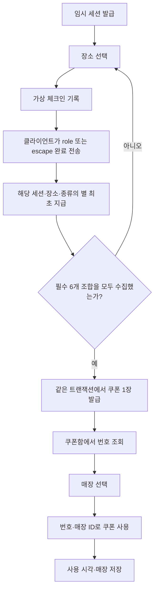
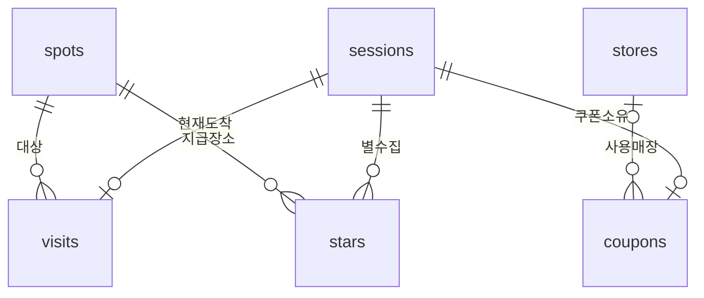

# 별 헤는 밤 — 현재 백엔드 설계 기록

작성일: 2026-10-30
대상: `Rest-Backend`, 버전 표기 0.2.0, 별 6개 수집 규칙

이 문서는 현재 코드를 대조한 설계 기록이다. **확정된 사업 정책이나 앞으로 적용할 재설계안이 아니다.**
핵심 코드·Swagger 샘플·테스트는 별 6개 수집 규칙을 따른다.
원본 문서의 제안, 사용자가 진행을 요청한 기능, 에이전트가 선택한 세부 구현을 구분한다.
진행 요청을 받은 사실이 모든 컬럼과 정책 수치에 대한 개별 확정을 의미하지는 않는다.

## 1. 근거와 결정 범위

기준 자료는 로컬 `docs/docu.md`, `docs/백엔드 수정사항.md`, 이전 `docs/API.md`와
와이어프레임 PDF, 그리고 대화 중 사용자의 지시다. `docs/`는 현재 Git 제외 대상이므로
저장소를 새로 받으면 이 원본 자료가 없을 수 있다. 현재 API 계약은 [API.md](API.md)를 따른다.

| 항목 | 근거 | 현재 구현과 판단 주체 |
|---|---|---|
| FastAPI + SQLite, REST JSON `/api/v1` | docu.md | 문서의 개발 방향을 따름 |
| sessions/spots/visits/stars/coupons/stores | 현재 database.py·migrations.py | 활성 테이블 6개 |
| 임시 session_id, 가상 체크인, 완료 신호 신뢰 | docu.md 및 현재 구현 | 세션으로 진행 상태를 구분하고 시연 범위 유지 |
| 현재 도착 장소 하나 유지 | 사용자의 장소 변경 처리 요청 | 다른 장소 체크인 시 이전 도착 행 삭제. 받은 별·쿠폰은 유지 |
| 세션·장소·종류별 별 중복 방지 | 현재 스키마 | UNIQUE(session_id, spot_id, kind)와 트랜잭션 |
| 조건 충족 시 쿠폰 자동 발급, 조회, 1회 사용 | 현재 rules.py·coupons.py | 필수 6개 조합 완료 시 세션당 1장. 별 지급과 발급은 한 트랜잭션 |
| 서버의 완료 기록 단위 | 현재 요청 모델·별 라우터 | 장소별 role/escape 완료 기록 |
| 번호·매장 ID로 쿠폰 사용 | 수정사항.md §1-2, 후속 진행 요청 | Swagger 08번에서 code와 store_id로 사용 |
| expires_at과 만료 처리 | 수정사항.md §1-3, 후속 진행 요청 | 만료 상태 계산 방식·과거 데이터 보정은 에이전트 판단 |
| 매장 좌표·영업 정보 | 수정사항.md §1-4, 후속 진행 요청 | 실제 정보가 없어 가상 값 사용. 시간 계산·필터 규칙은 에이전트 판단 |
| 4173 CORS, 설정값으로 출처 허용 | docu.md·수정사항.md §1-6 | 로컬 5173/4173 허용, 지정 목록이 기본 목록을 대체하도록 구현 |
| Swagger 체험 순서와 사전 예시 | 사용자의 Swagger·투어 번호 구분 요청 | 01~08 순서, 독립 세션 tour-1/2/3, 쿠폰 사용은 08번 |
| 별 6개 조합, 유효기간 14일 | 현재 rules.py·config.py | 조합은 코드 상수, 기간은 데모 환경변수. 코드의 고정 규칙을 사업 정책 승인으로 해석하지 않음 |
| UUID, UTC 문자열, 모듈 구성, 간단한 DB 이전 | 에이전트 판단 | 해커톤 시연 구현을 위한 기술 선택 |

PDF는 초기 기획 참고자료이며 현재 DB 설계를 그대로 정의한 자료가 아니다.
Docker는 컨테이너에서 실행·테스트한다는 뜻으로 정리되었고, Dockerfile 작성·EC2 운영은 현재 작업 범위가 아니다.

## 2. 현재 서비스 흐름



현재 서버는 a/b/c 세 장소의 `role`(역할극)과 `escape`(방탈출)를 각각 기록한다.
완료 요청에는 session_id, spot_id, kind가 필요하다. 같은 장소에서 한 번 체크인하면
다른 장소로 이동하기 전까지 두 종류의 완료 요청에 사용할 수 있다. 각 조합은 별 1개다.
장소를 바꾸면 이전 도착 기록을 삭제한다. 현재 장소 외 완료 요청은 409이며,
미완료 체험을 이어 하려면 해당 장소에 다시 체크인해야 한다. 받은 별·쿠폰은 유지한다.
kind 없는 요청은 422다.

쿠폰 발급 API는 따로 없다. 완료 요청의 `coupon_issued: true`가 새 자동 발급을 뜻한다.
`app/rules.py`의 필수 집합 `{a,b,c} × {role,escape}`를 모두 수집해야 발급한다.
필수 수집 조합은 코드 상수로 관리한다.

## 3. DB 저장 방식과 관계

- DB: SQLite, Python 표준 `sqlite3` 사용. ORM은 도입하지 않음.
- 기본 파일: `backend/data/starry-night.sqlite3`.
- DATABASE_PATH 지정 가능. 상대 경로는 실행 폴더 기준.
- 요청마다 연결을 만들고 종료 시 닫음. timeout 10초, 외래키 검사 활성화.
- FastAPI 작업 스레드 이동을 허용하되 연결을 요청 사이에 공유하지 않음.
- 일반 세션·방문·별·쿠폰 ID는 앱에서 UUID4 문자열로 생성.
- 스팟·데모 매장·Swagger 샘플 ID는 고정 문자열.
- 시각은 앱에서 ISO 8601 UTC 문자열로 저장. SQLite 자체의 날짜 타입·타임존 검증은 없음.



PK는 기본키, FK는 외래키다. 아래는 **현재 코드로 초기화한 최종 컬럼**을 정리한 것이다.
매장 열 추가와 별·쿠폰 테이블 이전은 §9를 따른다.

### 3.1 sessions — 체험 식별

| 필드 | SQLite 타입·제약 | 설명 |
|---|---|---|
| id | TEXT PK | 일반 요청은 UUID, 샘플은 고정 문자열 |
| created_at | TEXT NOT NULL | 생성 시각 |

계정·로그인이 아니다. 세션 만료, 계정 연결, 기기 간 복구나 소유자 인증은 없다.

### 3.2 spots — 투어 장소

| 필드 | SQLite 타입·제약 | 설명 |
|---|---|---|
| id | TEXT PK | a/b/c |
| name | TEXT NOT NULL | 장소 이름 |
| description | TEXT NOT NULL | 설명 |
| display_order | INTEGER NOT NULL UNIQUE | 표시 순서 |

a=관사 16호, b=관사 42호, c=헤레디움. 관사 42호 실제 사용 가능 여부는 미확정이다.
스팟 좌표, 작품·영상·체험 종류를 저장하는 컬럼은 없다.

### 3.3 visits — 현재 도착 장소

| 필드 | SQLite 타입·제약 | 설명 |
|---|---|---|
| id | TEXT PK | 방문 ID |
| session_id | TEXT NOT NULL FK → sessions.id | 체험 세션 |
| spot_id | TEXT NOT NULL FK → spots.id | 장소 |
| created_at | TEXT NOT NULL | 현재 장소에 체크인한 시각 |

UNIQUE(session_id, spot_id)와 세션별 고유 인덱스로 세션당 최대 1행을 유지한다.
같은 장소의 재체크인은 기존 행·시각을 유지한다. 다른 장소에 체크인하면 이전 행을 삭제하고
새 도착 기록을 저장한다. 삭제·삽입은 BEGIN IMMEDIATE 트랜잭션 하나에서 처리한다.
실제 좌표·GPS·QR 인증 기록은 저장하지 않는다.

### 3.4 stars — 체험 종류별 완료·별 기록

| 필드 | SQLite 타입·제약 | 설명 |
|---|---|---|
| id | TEXT PK | 지급 ID |
| session_id | TEXT NOT NULL FK → sessions.id | 체험 세션 |
| spot_id | TEXT NOT NULL FK → spots.id, CHECK IN (a,b,c) | 완료 장소 |
| kind | TEXT NOT NULL CHECK IN (role,escape) | 체험 종류 |
| created_at | TEXT NOT NULL | 지급 시각 |

UNIQUE(session_id, spot_id, kind). 각 행이 별 1개다.
합계는 COUNT(*)로 계산한다. 조회 순서는 장소 표시 순서, 같은 장소에서는 role → escape다.
별도 experiences/completions 테이블은 없고 실제 AR 완료·시청 비율은 검증하지 않는다.
체크인 선행 여부는 API에서 확인하며, stars와 visits 사이의 직접 FK는 없다.

### 3.5 coupons — 발급·사용 기록

| 필드 | SQLite 타입·제약 | 설명 |
|---|---|---|
| id | TEXT PK | 발급 쿠폰 ID |
| session_id | TEXT NOT NULL UNIQUE FK → sessions.id | 세션당 최대 1장 |
| title | TEXT NOT NULL | 발급 당시 제목 복사 |
| benefit | TEXT NOT NULL | 발급 당시 혜택 복사 |
| code | TEXT NOT NULL UNIQUE | 앱에서 만드는 숫자 12자리 문자열 |
| status | TEXT NOT NULL CHECK IN (issued, redeemed) | 저장 상태 |
| issued_at | TEXT NOT NULL | 발급 시각 |
| expires_at | TEXT NOT NULL | 만료 시각 |
| redeemed_at | TEXT, NULL 가능 | 사용 시각 |
| store_id | TEXT FK → stores.id, NULL 가능 | 번호 기반 사용 매장 |

같은 세션은 사용·만료 후에도 다시 발급하지 않는다.
title/benefit은 발급 시 환경변수에서 읽어 저장하므로 이후 설정 변경이 과거 문구를 바꾸지 않는다.
code는 문자열이므로 맨 앞 0을 보존한다. 길이·ASCII 숫자 형식은 요청 모델에서 검사하며,
DB CHECK로 12자리 형식을 강제하지는 않는다.

**만료 설계:** DB에 expired를 저장하지 않는다. 미사용 쿠폰의 현재 시각이 expires_at 이상이면
API에서 expired로 반환한다. 별도 스케줄러는 없다. 이미 사용한 쿠폰은 날짜가 지나도 redeemed다.
이는 수정 문서에 있던 필드 요구를 구현하면서 에이전트가 선택한 처리 방식이다.

store_id는 **실제로 사용한 매장**이며 사용 가능 매장 목록이 아니다.
매장 기록이 없는 과거 쿠폰의 store_id는 NULL일 수 있다.
발급 기준·유효기간 설정의 변경 이력을 별도 정책 버전으로 저장하지는 않는다.

### 3.6 stores — 매장 정보

| 필드 | SQLite 타입·제약 | 설명 |
|---|---|---|
| id | TEXT PK | 매장 ID |
| name | TEXT NOT NULL | 이름 |
| description | TEXT NOT NULL | 설명 |
| display_location | TEXT NOT NULL | 표시용 위치 문구 |
| accepts_coupon | INTEGER NOT NULL CHECK IN (0,1) | 쿠폰 사용 가능 여부 |
| is_demo | INTEGER NOT NULL CHECK IN (0,1) | 가상 데이터 여부 |
| lat | REAL, NULL 가능 | 위도 |
| lng | REAL, NULL 가능 | 경도 |
| opens_at | TEXT, NULL 가능 | HH:MM 개점 시각 |
| closes_at | TEXT, NULL 가능 | HH:MM 폐점 시각 |

좌표·시간의 범위와 문자열 형식을 DB 자체의 CHECK로 강제하지는 않는다.
API 응답의 hours/open_now/night는 별도 저장하지 않고 계산한다.
요일별 일정·휴일·브레이크타임·쿠폰 종류별 제휴 관계 테이블은 없다.

## 4. 데이터 변경 규칙과 트랜잭션

| 동작 | 현재 처리 |
|---|---|
| 세션 발급 | 매번 새 UUID 저장 |
| 체크인 | BEGIN IMMEDIATE → 세션·장소 검증 → 이전 장소 도착 기록 삭제 → 새 장소 저장 → 커밋. 같은 장소는 기존 기록 유지 |
| 체험 완료 | BEGIN IMMEDIATE → 세션·장소·방문 확인 → 장소·종류별 별 최초 삽입 → 행 수 집계 → 필수 조합 확인 및 조건부 쿠폰 발급 → 커밋 |
| 별 재요청 | 추가 지급 없음. 현재 수집 조합으로 쿠폰 조건은 다시 확인 |
| 발급 도중 실패 | 같은 트랜잭션의 별 지급도 롤백 |
| 번호로 사용 | BEGIN IMMEDIATE → 매장 존재·accepts_coupon 확인 → 번호 조회 → 이미 사용·만료 확인 → 조건부 UPDATE → 커밋 |
| 사용 동시 요청 | status=issued 조건부 UPDATE와 쓰기 트랜잭션으로 하나만 성공 |
| 쿠폰 조회 | 소유 세션별 목록, 현재 시각으로 표시 상태 계산 |

번호 사용의 오류 확인 순서는 매장 → 사용 가능 여부 → 쿠폰 → 사용 상태·만료다.
따라서 만료된 쿠폰이라도 매장 정보가 틀리면 매장 오류를 먼저 반환할 수 있다.
사용 완료는 409 already_redeemed, 만료된 미사용은 410 coupon_expired다.
매장 자격증명·QR 서명은 검증하지 않는다. 등록 매장 확인은 매장 직원 인증과 다르다.

일반 FK/PK/UNIQUE에 의한 인덱스 외에 별도 성능 인덱스는 작성하지 않았다.
삭제·보존 기간·세션 종료·연쇄 삭제 정책과 관리 API도 구현하지 않았다.

## 5. 매장 정보와 계산 규칙

기본 데이터는 실제 제휴 매장이 아닌 아래 가상 자료다.

| ID | 이름 | 가상 좌표(lat, lng) | 가상 영업시간(KST) | 쿠폰 |
|---|---|---|---|---|
| demo-store-1 | [가상] 별빛 카페 | 36.3328, 127.4376 | 11:00–22:00 | 가능 |
| demo-store-2 | [가상] 골목 카페 | 36.3335, 127.4389 | 12:00–02:00 | 가능 |
| demo-store-3 | [가상] 밤하늘 카페 | 36.3259, 127.4317 | 09:00–20:00 | 불가 |

hours는 개점·폐점 문자열을 연결한다. open_now는 UTC+9 현재 시각으로 계산하며
개점 시각은 포함하고 폐점 시각은 제외한다. 개점보다 폐점이 이르면 자정 넘는 영업,
같으면 휴무로 처리한다. night는 자정 넘는 영업 또는 21시 이후 폐점일 때 true다.
이 규칙은 구현 선택이며 실제 매장 운영 규칙으로 확정된 것이 아니다.

매일 동일 일정이라는 가정이다. 필요한 시간 정보가 없으면 hours/open_now/night는 NULL이다.
accepts_coupon/open_now/night 필터는 AND이며 NULL은 true/false 필터 모두에서 제외한다.
좌표는 지도 표시 시연용이고, 실제 목적지·검증된 좌표로 쓰는 자료가 아니다.

## 6. 초기 데이터와 Swagger 샘플

### 공통 초기 데이터

init_db()는 스팟 3곳·가상 매장 3곳을 준비하고 별·쿠폰 이전 함수를 호출한다.
현재 도착 장소 이전 함수도 호출해 세션당 도착 기록 하나를 보장한다.
스팟은 이미 있으면 덮어쓰지 않는다. 가상 매장은 기본 행을 보존하고, 알려진 ID이면서
is_demo=1인 경우에만 좌표 두 값이 모두 없거나 개점·폐점 두 값이 모두 없을 때 채운다.

### Swagger 전용 시나리오

`app.demo` lifespan은 init_db() 다음에 샘플을 생성하도록 작성되어 있다.
tour-1, tour-2, tour-3 세 세션을 준비하며, 각 세션은 처음 생성할 때 도착·별·쿠폰 기록이 없다.
세 세션의 진행 상태는 서로 독립적이다.

| session_id | 시작 상태 |
|---|---|
| tour-1 | 도착·별·쿠폰 없음 |
| tour-2 | 도착·별·쿠폰 없음 |
| tour-3 | 도착·별·쿠폰 없음 |

03~06에서 같은 tour 번호를 선택한다. 각 장소에 체크인한 뒤 완료 요청의
tour-1-a-role/tour-1-a-escape처럼 투어·장소·종류가 표시된 예시를 실행한다.
각 완료 예시에는 session_id, spot_id, kind가 포함된다.
쿠폰 번호·ID는 해당 투어에서 실제 발급된 값을 조회해 사용한다.

샘플은 세션이 이미 있으면 건너뛰며 재시작으로 사용 기록을 초기화하지 않는다.
기존 세션 데이터도 삭제하지 않는다. 별도 초기화 API는 없다. 같은 SQLite 파일과 고정 이름을 사용하며 sessions/coupons에
별도 is_demo 필드는 없다.

## 7. 환경설정과 데모 수치

| 설정 | 기본값 | 읽는 시점·영향 |
|---|---|---|
| DATABASE_PATH | backend/data/starry-night.sqlite3 | 연결 시. 운영 중 경로를 바꾸는 용도로 설계하지 않음 |
| DEMO_COUPON_VALID_DAYS | 14 | 시작 시 검증, 발급 시 읽음. 허용 1~36500일 |
| DEMO_COUPON_TITLE | [데모] 카페 체험 쿠폰 | 발급 시 읽어 저장 |
| DEMO_COUPON_BENEFIT | [가상 혜택] 음료 1,000원 할인 | 위와 동일 |
| CORS_ORIGINS | HTTP localhost/127.0.0.1의 5173·4173 | 앱 생성 시. 지정 목록으로 기본 목록 대체 |

체험별 별 1개와 필수 6개 조합은 코드에 고정되어 있다.
14일, 혜택 문구, 유효기간 상한, 가상 좌표·영업시간은 데모 값이다.
실제 매장과의 합의나 확정 사업 정책을 의미하지 않는다. .env 파일은 자동 로딩하지 않는다.

## 8. API와 모듈 구성

| API | 요청의 핵심 | 결과 |
|---|---|---|
| GET /api/v1/health | 없음 | 상태 확인, 로컬 앱 제공 |
| POST /api/v1/sessions | 없음 | 새 session_id |
| GET /api/v1/spots | 없음 | 장소 목록 |
| POST /api/v1/checkin | session_id, spot_id | 가상 도착 기록 |
| POST /api/v1/experiences/complete | session_id, spot_id, kind(role/escape) | 조합별 별 지급·6개 조합 완료 시 자동 쿠폰 발급 |
| GET /api/v1/stars | session_id 쿼리 | spot_id·kind·created_at 기록과 행 수 합계 |
| GET /api/v1/coupons | session_id 쿼리 | 쿠폰과 계산된 상태 |
| POST /api/v1/coupons/redeem-by-code | code, store_id | 번호 기반 사용 |
| GET /api/v1/stores | 선택적 필터 | 위치·영업 정보 |

요청·응답 모델은 `app/schemas/`, 라우터는 `app/routers/`에 둔다.
`database.py`는 연결·공통 테이블 초기화, `migrations.py`는 별·쿠폰·도착 기록 이전,
`rules.py`는 필수 수집 조합, `seed.py`는 공통 초기 데이터,
`coupons.py`는 발급·만료, `stores.py`는 시간 계산을 담당한다.
`demo.py`는 독립 실행용 앱, `demo_scenarios.py`는 Swagger 설명·예시·투어 세션 생성을 담당한다.

Swagger 순서는 01 시작 → 02 장소 → 03 체크인 → 04 완료 → 05 별 → 06 쿠폰 → 07 매장 → 08 사용이다.
현재 계약에서는 장소별로 체크인 후 role/escape 완료를 각각 호출해야 한다.
쿠폰 사용은 08번 번호 기반 API로 통일하고 health만 참고 항목으로 둔다.
Swagger 설명·샘플·완료 예시는 필수 6개 조합을 따른다.
포트 전달 경로를 유지하도록 명세 파일 URL과 OpenAPI 서버 URL은 상대 경로를 사용한다.

## 9. DB 변경·호환 처리

마이그레이션 버전 관리 도구나 이력 테이블은 없다. init_db()의 BEGIN IMMEDIATE 안에서
공통 테이블 준비·매장 열 추가와 migrate_collection(db, valid_days)를 수행한다.
이어 migrate_current_visit(db)로 세션별 현재 도착 장소를 정리한다.

- 세션에 도착 기록이 여러 개면 created_at이 가장 최근인 하나만 남긴다.
  시각이 같으면 나중에 삽입한 행을 유지한다. 별·쿠폰 기록은 변경하지 않는다.
- visits(session_id)의 고유 인덱스로 세션당 최대 도착 기록 1개를 강제한다.
- 기존 stars에 kind가 없으면 legacy_stars_v020으로 이름을 바꾸고 새 stars를 만든다.
  과거 건물 완료를 role/escape로 추측하지 않는다. 보관된 과거 별은 현재 조회·발급 판정에서
  제외되며 이미 발급된 쿠폰은 유지한다.
- coupons가 없으면 새 테이블을 만든다. 이전 형식의 쿠폰 테이블은 현재 컬럼을
  coupons_next에 복사한 뒤 교체한다.
- 이전 대상 쿠폰에 같은 session_id가 둘 이상 있으면 RuntimeError로 중단한다.
  자동으로 하나를 선택하거나 삭제하지 않는다.
- 만료일이 없으면 발급일 + 이전 시점의 DEMO_COUPON_VALID_DAYS로 보정한다.
  기존 만료일·문구·번호·사용 기록은 유지한다. 새 쿠폰 테이블은 expires_at NOT NULL이다.
- 세션당 UNIQUE 제약으로 재발급을 막는다.

예외 발생 시 같은 초기화 트랜잭션은 롤백된다. 단, 일부 열의 유무로 형식을 판정하므로
임의의 옛 스키마·제약 불일치·기존 legacy_stars_v020과의 이름 충돌까지 처리하는
일반 이전 체계는 아니다. 과거 별을 새 조합으로 복구하거나 보관 테이블을 정리하는 기능은 없다.

## 10. 현재 제약과 재설계 시 결정할 사항

다음은 현재 구현의 한계 또는 선택지이며, 지금 변경하기로 확정한 요구사항이 아니다.

| 검토 항목 | 현재 상태 | 결정이 필요한 내용 |
|---|---|---|
| 체험 기록 단위 | 장소·role/escape별 별 기록, 총 6개 조합 | 실제 AR 완료 검증 필요 여부 |
| 발급 조건 | 필수 6개 조합 전체 수집 | 향후 장소·종류 변경 시 정책과 이전 방식 |
| 쿠폰 정책 관리 | 조합은 코드 상수, 문구·기간은 발급 시 환경변수 | 정책 버전·관리 방식 필요 여부 |
| 쿠폰·매장 관계 | 모든 accepts_coupon 매장 사용 가능 | 쿠폰 종류별 제휴 매장 관계가 필요한지 |
| 쿠폰 상태 | 만료는 계산 상태 | 만료를 저장 상태로 바꿀지, 이력 테이블이 필요한지 |
| 샘플 데이터 | 로컬 앱의 같은 DB에 고정 ID로 저장 | 별도 DB·설정·생성 스크립트로 분리할지 |
| 초기화와 이전 | init_db에서 별도 이전 함수 호출, 열 유무 확인 | 버전 있는 변경 이력과 데이터 이전 정책 |
| 영업시간 | 매일 동일·시간 쌍 하나 | 요일·휴일·휴게시간 필요 여부 |
| 세션 생명주기 | 무기한, 인증 없음 | 시연 범위 안에서 보존·재시작 방식을 어떻게 할지 |
| 실제 데이터 | 스팟 외 매장·혜택·좌표는 데모 | 확정 자료와 교체 절차 |

로그인·관리자·통계·실제 GPS·QR 서명·AR 검증을 자동으로 다음 범위에 포함하지 않는다.
필요하다면 별도 요구사항과 범위를 먼저 정해야 한다.

## 11. 검증 상태

최종 코드 검증일: 2026-10-30. 프로젝트 .venv에서 전체 57개 테스트와 의존성 검사가 통과했다.
backend 폴더에서 재현하는 명령은 다음과 같다.

```bash
python -m pip install -r ../requirements-dev.txt
python -m unittest discover -s tests -v
python -m pip check
```

검증 범위는 세션·체크인, 체험 종류별 별 지급·중복 방지·세션 격리, 필수 6개 조합 완료 시
쿠폰 발급, 동시 발급·사용 방지, 발급 실패 시 별 롤백, 만료 경계, 번호 기반 사용,
매장 영업시간 경계·필터, CORS, Swagger 직접 접속·프록시 경로와 실행 예시다.
DB 이전 테스트에서는 기록 보존, 과거 별 별도 보관, 만료일 1회 보정,
한 세션의 중복 쿠폰 발견 시 초기화 전체 롤백과 반복 초기화를 확인했다.
현재 도착 장소 전환·동시 체크인·잘못된 장소 변경 시 기존 위치 보존,
이전 장소 완료 차단·재방문 후 중복 지급 방지와 기존 도착 기록 정리도 확인했다.

기존 DB를 읽기 전용으로 복사한 임시 DB에서 실제 Uvicorn 서버를 실행해
세션 발급 → 체크인 → 별 6개 → 쿠폰 발급·사용과 오류 응답을 확인했다.
재시작 후 별·사용 기록 보존과 SQLite integrity_check·foreign_key_check도 통과했다.
이 검증에서는 원본 DB를 수정하지 않았다. 현재 장소 변경은 기존 DB 복사본에서
a→b→a 이동과 재시작 후 차단·별 보존을 확인했다.
tour-1/2/3의 빈 초기 상태·투어 간 데이터 격리·재시드 후 보존과
Swagger 예시를 이용한 완료·08번 쿠폰 사용도 전체 테스트에 포함된다.

실제 프론트·AR·별도 배포 환경의 연동 검증은 포함하지 않는다.

구현 근거: [DB](app/database.py), [이전](app/migrations.py), [수집 규칙](app/rules.py),
[초기 데이터](app/seed.py), [설정](app/config.py),
[쿠폰 발급·만료](app/coupons.py), [쿠폰 사용](app/routers/coupons.py),
[별 지급](app/routers/stars.py), [영업시간](app/stores.py),
[로컬 앱](app/demo.py), [Swagger 샘플](app/demo_scenarios.py), [테스트](tests/).
